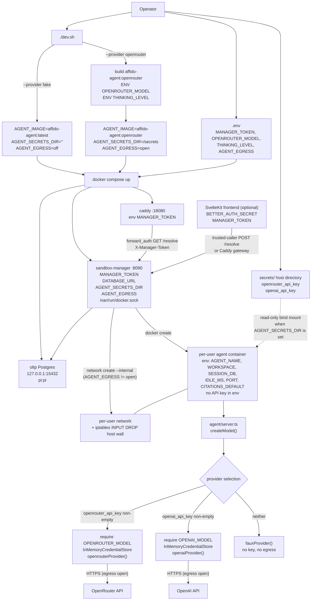
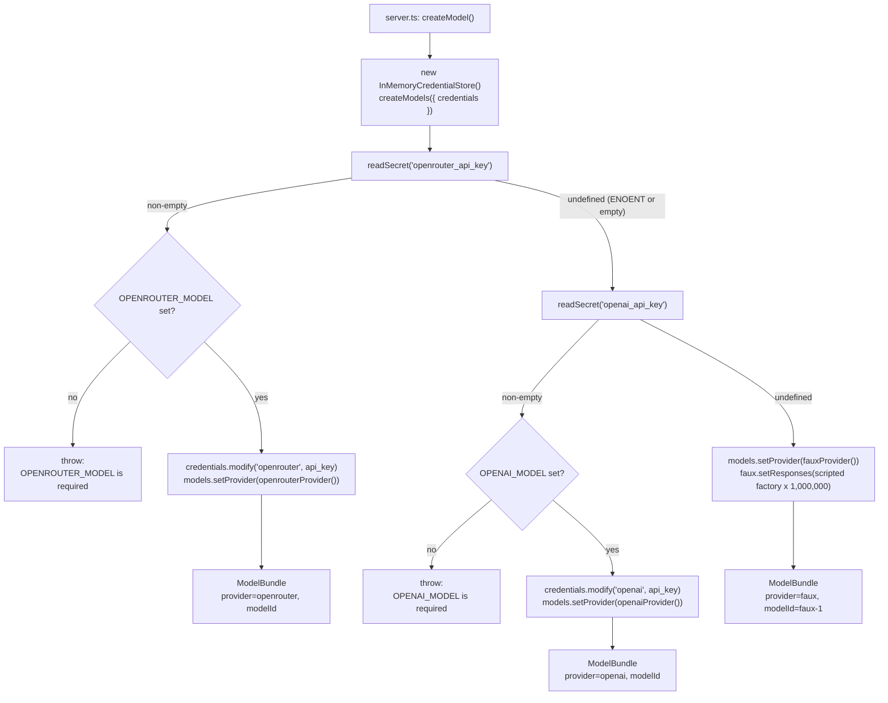
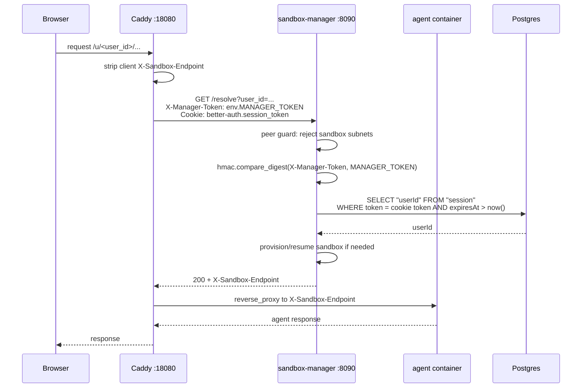

# Audit — secrets, API keys and AI LLM providers

Status: factual audit of the code at the time of writing. No runtime probing was
performed; every statement below is read from the repository. Proposed designs
(RFC 0004) are marked as proposals and are not implemented.

## 1. Scope and method

Files read in full or in the parts that own the behavior:

- Provider selection: `agent/model.ts`, `agent/server.ts`, `agent/types.ts`,
  `agent/harness.ts`, `agent/Dockerfile`, `agent/package.json`.
- Provisioning and secret mount: `sandbox-manager/sandbox_manager.py`,
  `docker-compose.yml`, `docker-compose.override.yml`, `dev.sh`,
  `openrouter-setup.sh`, `.env.example`, `secrets/.gitignore`.
- Control-plane credentials: `caddy/Caddyfile`, `frontend/src/env.ts`,
  `frontend/src/lib/server/auth.ts`, `frontend/src/lib/server/sandbox.ts`,
  `frontend/src/routes/api/chat/+server.ts`.
- Supporting docs: `docs/rfc/0004-multi-tenant-llm-keys.md`,
  `docs/rfc/0001-pi-ai-optional-provider-dependencies.md`,
  `docs/rfc/0003-python-sandbox-manager.md`, `docs/security.md`, `README.md`,
  `CHANGELOG.md`.
- Gates: `verify.sh`, `e2e-test/security.sh`, `e2e-test/security-probe.mjs`,
  `e2e-test/lib.sh`.

## 2. Credential inventory

### 2.1 Secrets that protect infrastructure

| Name | Kind | Declared / set in | Read by | Stored where | Rotation in code |
|---|---|---|---|---|---|
| `MANAGER_TOKEN` | Shared secret, HTTP header `X-Manager-Token` | `docker-compose.yml:9` (Caddy), `:41` (manager), compose fallback `dev-manager-token` (refused at manager startup since the 2026-10 pentest fix; `./dev.sh up` generates a random value in `.env`); `frontend/.env.example`; `frontend/src/env.ts:22` | Caddy `forward_auth` (`caddy/Caddyfile:17`), manager `Handler.authorized` (`sandbox_manager.py:724`), frontend trusted-caller mode (`frontend/src/lib/server/sandbox.ts:36`) | Compose environment; process memory | None. Restart with a new value. |
| `BETTER_AUTH_SECRET` | Signing secret for better-auth | `frontend/.env.example:11`, `frontend/src/env.ts:8` | `betterAuth({ secret })` (`frontend/src/lib/server/auth.ts:11`) | Frontend environment; process memory | None in this repo. |
| Postgres credentials `pi:pi` | Database password | `docker-compose.yml:20-22`, manager `DATABASE_URL` at `:39` | Postgres, manager, frontend `DATABASE_URL` | Compose environment; Postgres volume | None in this repo. |
| Session cookie `better-auth.session_token` | User session credential | Issued by better-auth; validated by manager (`AUTH_COOKIE_NAME`, `sandbox_manager.py:72`) | Caddy forwards it; manager queries `"session"` (`sandbox_manager.py:236-243`) | Postgres `"session"` table | Session lifecycle owned by better-auth. |
| Docker socket `/var/run/docker.sock` | Host control capability | `docker-compose.yml:51` | Sandbox manager only | Host socket bind mount | N/A |

### 2.2 Secrets that authenticate to model providers

| Name | Kind | Source | Read by | Landed in | Rotation in code |
|---|---|---|---|---|---|
| `openrouter_api_key` | Provider API key, plain file | Host `secrets/` directory (`secrets/.gitignore`); checked by `dev.sh:113`, listed by `dev.sh:376` | `readSecret("openrouter_api_key")` (`agent/model.ts:161`) | Mounted read-only at `/run/secrets/openrouter_api_key` in every sandbox when `AGENT_SECRETS_DIR` is set (`sandbox_manager.py:377-380`); then `InMemoryCredentialStore` (`agent/model.ts:165`) | None. Replace the file and recreate sandboxes. |
| `openai_api_key` | Provider API key, plain file | Host `secrets/` directory; listed by `dev.sh:376` | `readSecret("openai_api_key")` (`agent/model.ts:169`) | Same mount at `/run/secrets/openai_api_key`; then `InMemoryCredentialStore` (`agent/model.ts:173`) | None. Replace the file and recreate sandboxes. |
| `llm_key_kek` | Key-encryption key for the proposed gateway | `docs/rfc/0004-multi-tenant-llm-keys.md:429` | Proposed `llm-gateway` only | Proposed `secrets/llm_key_kek` | Proposal only; no file and no code in the repo. |

Current local state observed (not secret content):

- `secrets/openrouter_api_key` exists, 74 bytes, mode `600`.
- `secrets/openai_api_key` exists, 0 bytes, mode `644`.
- `secrets/llm_key_kek` does not exist.
- `.env` exists and is untracked; it contains only `OPENROUTER_MODEL=deepseek/deepseek-v4.1-flash-1017`.
- `git ls-files` contains only `.env.example` and `frontend/.env.example`; no secret file is tracked.
- `secrets/` is ignored twice: top-level `.gitignore` and `secrets/.gitignore` (`*` except `.gitignore`).

### 2.3 Non-secret provider configuration

| Name | Kind | Where it is set | Where it lands |
|---|---|---|---|
| `OPENROUTER_MODEL` | Model id, not a secret | Host `.env`; `dev.sh` build arg (`dev.sh:149-152`) | `ENV` in the derived image `affido-agent:openrouter`; read by `agent/model.ts:163` |
| `OPENAI_MODEL` | Model id, not a secret | No compose/dev.sh path sets it | Read by `agent/model.ts:171`; only reachable if the agent image is run directly with the variable |
| `THINKING_LEVEL` | Reasoning effort, not a secret | Host `.env`; `dev.sh` build arg (`dev.sh:150-154`) | `ENV` in the derived image; read by `agent/server.ts:95` |
| `AGENT_SECRETS_DIR` | Host path, not the key itself | `dev.sh:93-101` (empty for fake, `<root>/secrets` for openrouter); forwarded by `docker-compose.override.yml:18` | Manager environment; used by `create_args()` to build a bind mount |
| `AGENT_EGRESS` | Network mode, not a secret | `dev.sh:222-236`; default `off` in `docker-compose.yml:49` | Manager network creation (`sandbox_manager.py:107-118`) |
| `SECRET_DIR` | Secret directory path | Not set by compose or the manager | `agent/model.ts:21` defaults to `/run/secrets`; an operator can override it when running the image directly |

## 3. Provider inventory

Only three provider factories are imported by the agent:

| Provider id | Factory | Authentication | Model variable | Network need | Status |
|---|---|---|---|---|---|
| `openrouter` | `openrouterProvider()` (`agent/model.ts:17`) | `openrouter_api_key` file | `OPENROUTER_MODEL` required | HTTPS to the provider; sandbox needs egress | Implemented |
| `openai` | `openaiProvider()` (`agent/model.ts:16`) | `openai_api_key` file | `OPENAI_MODEL` required | HTTPS to the provider; sandbox needs egress | Implemented |
| `faux` | `fauxProvider()` (`agent/model.ts:11-14`) | None | none (`faux-1` hardcoded at `agent/model.ts:185`) | None; runs offline | Default |

Provider selection is a fixed if/else at process start (`agent/model.ts:159-185`),
called once from `agent/server.ts:87`:

1. If `readSecret("openrouter_api_key")` returns a non-empty value:
   - require `OPENROUTER_MODEL`, else throw;
   - `credentials.modify("openrouter", ... api_key ...)`;
   - `models.setProvider(openrouterProvider())`;
   - return `{ provider: "openrouter", modelId }`.
2. Else if `readSecret("openai_api_key")` returns a non-empty value:
   - require `OPENAI_MODEL`, else throw;
   - `credentials.modify("openai", ... api_key ...)`;
   - `models.setProvider(openaiProvider())`;
   - return `{ provider: "openai", modelId }`.
3. Else use the faux provider and return `{ provider: "faux", modelId: "faux-1" }`.

`readSecret()` (`agent/model.ts:23-32`) reads `join(SECRET_DIR, name)`, trims
whitespace, returns `undefined` on `ENOENT` or an empty file, and rethrows other
errors.

The key is never read from `process.env`. `agent/model.ts:1` states this, and the
only key inputs to the process are the secret files plus the non-secret model
variables listed above.

### 3.1 What the provider SDK surface contains

`agent/package.json:14` depends on `@earendil-works/pi-ai` 1.3.0. The installed
package metadata declares all five provider SDKs as regular dependencies:

- `@anthropic-ai/sdk` 0.129.0
- `@aws-sdk/client-bedrock-runtime` 3.1127.0
- `@google/genai` 2.21.0
- `openai` 7.19.0
- `@smithy/node-http-handler` 4.12.1

`agent/Dockerfile:13` uses `npm ci --omit=dev --ignore-scripts`, not
`--omit=optional`. RFC 0001 proposes moving these SDKs to
`optionalDependencies`; its status is Draft and the installed `pi-ai` 1.3.0
still lists them as regular dependencies. The agent code imports only the
`faux`, `openai`, and `openrouter` provider entry points.

### 3.2 Who can choose the provider in practice

> **In practice the only operator-facing provider switch is `fake` vs
> `openrouter`, and it is the operator's decision, not the user's.**

- `./dev.sh up|reload|build --provider fake|openrouter` accepts only those two
  values; `agent_image()` rejects anything else (`dev.sh:83-91,414-418`).
- `openai` exists in `agent/model.ts:169-175`, but neither `dev.sh` nor
  `create_args()` sets `OPENAI_MODEL`. Reaching that branch requires running the
  agent image directly with the variable; it is not a switch the operator can
  select through `./dev.sh`.
- Both choices happen on the host, before `docker create`. There is no
  end-user or tenant surface for provider or model selection: `POST /prompt`
  accepts only `prompt`, `requestId` and `citations` (`agent/tools.ts:364-377`),
  and the frontend chat route forwards only those fields
  (`frontend/src/routes/api/chat/+server.ts:19-22,144-148`).
- One stack has one `AGENT_IMAGE` and one `AGENT_SECRETS_DIR`, so one user
  cannot choose a provider or key different from another user's. Per-tenant
  selection is RFC 0004's proposal, not an implemented feature.

## 4. Flowcharts

### 4.1 Provisioning and secret flow (implemented path)



Facts behind the chart:

- `dev.sh:93-101` selects the secrets directory; `dev.sh:222-236` exports
  `AGENT_IMAGE`, `AGENT_SECRETS_DIR`, `AGENT_EGRESS` to compose.
- `docker-compose.override.yml:18-19` forwards `AGENT_SECRETS_DIR` and
  `AGENT_IMAGE` to the manager.
- `create_args()` (`sandbox_manager.py:355-381`) sets only `AGENT_NAME`,
  `WORKSPACE`, `SESSION_DB`, `IDLE_MS`, `PORT`, optional `CITATIONS_DEFAULT`,
  and the optional `-v <AGENT_SECRETS>:/run/secrets:ro` mount. It forwards no
  `*_MODEL`, no `THINKING_LEVEL`, no API key variable and no `SECRET_DIR`.
- `AGENT_EGRESS != "open"` creates the per-user network `--internal` with
  masquerading disabled (`sandbox_manager.py:107-118`); `dev.sh` sets
  `AGENT_EGRESS=open` only for `--provider openrouter`.
- The manager installs an iptables `INPUT DROP` host wall per sandbox bridge
  (`sandbox_manager.py:274-346`), fail-closed.
- `agent/server.ts:87` calls `createModel()` at startup, before the agent is
  constructed.

### 4.2 Provider selection (`createModel`)



### 4.3 Control-plane authentication and secret use



Facts:

- Caddy forwards `X-Manager-Token` from its own environment and copies only
  `X-Sandbox-Endpoint` from the manager (`caddy/Caddyfile:15-20`).
- The manager compares the header with `hmac.compare_digest`
  (`sandbox_manager.py:724-729`). If `MANAGER_TOKEN` is unset, `authorized()`
  returns `True` (`sandbox_manager.py:726-727`).
- `/healthz` is answered before the peer guard and before authorization
  (`sandbox_manager.py:765-766`); every other endpoint is behind both walls.
- The frontend's trusted-caller mode sends the same header
  (`frontend/src/lib/server/sandbox.ts:36`) and posts `{ user_id }` to
  `/resolve` (`:38-44`).

## 5. Where key material can be read

| Location | Key material present? | Evidence |
|---|---|---|
| Host `secrets/` directory | Yes, plain files | `secrets/openrouter_api_key` exists; `secrets/.gitignore` ignores all files |
| `affido-agent:*` image | No | `agent/Dockerfile` copies `package.json`, `package-lock.json` and explicit `.ts` files only; build context is `./agent`, so `secrets/` is not in it |
| Agent container environment | No API key | `create_args()` forwards no key; `docker inspect` shows no key. It does show non-secret `OPENROUTER_MODEL`/`THINKING_LEVEL` because they are image `ENV` |
| Agent container filesystem `/run/secrets` | Yes, when `AGENT_SECRETS_DIR` is set | Read-only bind mount at `sandbox_manager.py:380`; the same host directory for every sandbox |
| Agent process memory | Yes | `InMemoryCredentialStore` (`agent/model.ts:159-173`) |
| Agent session SQLite | No key; only `pi.agent` model ref and thinking level | `DurableHarness.#syncAgent` writes model/thinking to the conversation (`agent/harness.ts:235-249`) |
| Manager process memory | No key; holds `MANAGER_TOKEN`, `DATABASE_URL`, `AGENT_SECRETS_DIR` path | `sandbox_manager.py:45-72` |
| Control-plane Postgres | No provider key in implemented code | `SCHEMA` contains only `sandbox_registry` (`sandbox_manager.py:136-154`); `llm_key` tables exist only in RFC 0004 |
| Frontend process | No provider key; holds `BETTER_AUTH_SECRET`, `MANAGER_TOKEN` | `frontend/src/env.ts`, `frontend/src/lib/server/auth.ts` |
| Caddy process | `MANAGER_TOKEN` only | `docker-compose.yml:9` |

The sandbox's own `bash` tool runs in the same container and under the same UID
as the agent. The Dockerfile sets no `USER`, so the process runs as root by
default. A mounted key file is therefore readable from inside the sandbox. RFC
0004 §2.1 states this explicitly and gives the trace:

```text
docker exec u<slug> bash -lc 'cat /run/secrets/openrouter_api_key'
```

Deleting the file after boot does not remove the key from the agent process
memory. RFC 0004 §2.1 also states this.

The artifacts download path refuses symlinks, so
`ln -s /run/secrets/openrouter_api_key artifacts/leak` is not a download path
(`agent/artifacts.ts:51-70`). It is not a boundary against `bash`.

## 6. Key lifecycle in the implemented code

1. Operator writes the key into `secrets/openrouter_api_key` or
   `secrets/openai_api_key` by hand. No command in the repo creates or encrypts
   these files.
2. `./dev.sh up --provider openrouter` refuses to build unless
   `OPENROUTER_MODEL` is non-empty and `secrets/openrouter_api_key` is non-empty
   (`dev.sh:111-113`).
3. `dev.sh` builds `affido-agent:openrouter` with `ENV OPENROUTER_MODEL` and
   `ENV THINKING_LEVEL` (`dev.sh:145-155`). The key is not a build arg.
4. `dev.sh` starts compose with `AGENT_IMAGE=affido-agent:openrouter`,
   `AGENT_SECRETS_DIR=<root>/secrets`, `AGENT_EGRESS=open` (`dev.sh:222-236`).
5. The manager's `create_args()` adds
   `-v <AGENT_SECRETS>:/run/secrets:ro` for every sandbox
   (`sandbox_manager.py:377-380`).
6. The agent reads the key file once at process start and puts it in an
   in-memory credential store (`agent/model.ts:159-173`).
7. Rotation is manual: replace the file, then `./dev.sh reload` (or remove the
   sandbox containers) so new containers mount the new file. Existing
   containers keep the old file content until recreated; the key in their
   memory is also the old one.
8. Removing a model or provider requires `./dev.sh reload`; a container's
   environment and mounts are fixed at `docker create`. `dev.sh` warns about
   sandboxes whose image differs from the selected one
   (`dev.sh:199-211`).

There is no key pool, no per-tenant binding, no lease, no revocation, no
encryption at rest, and no gateway in the implemented code. Those are RFC 0004
proposals (`docs/rfc/0004-multi-tenant-llm-keys.md`), whose `llm-gateway/`
directory and `llm_key`/`llm_key_lease` tables do not exist in the repository.

## 7. Network and egress relationship to providers

- Default (`AGENT_EGRESS=off`): the per-user network is created `--internal`
  with `com.docker.network.bridge.enable_ip_masquerade=false`
  (`sandbox_manager.py:107-118`). The keyless faux provider needs no egress.
- OpenRouter mode: `dev.sh` sets `AGENT_EGRESS=open`, so the network is a plain
  bridge with routed egress. The host wall (iptables `INPUT DROP` per sandbox
  bridge) stays in both modes (`sandbox_manager.py:274-346`).
- The provider is reached directly by the agent process; there is no proxy in
  the implemented path. RFC 0004's `llm-gateway` is the proposed proxy.
- `verify.sh` runs the gate with `AGENT_IMAGE=affido-agent:latest` and
  `AGENT_SECRETS_DIR=` (empty), so the gate exercises the keyless faux provider
  and default `AGENT_EGRESS=off`. The security suite exercises containment in
  that default mode (`verify.sh`, `e2e-test/security.sh`).

## 8. Findings

These are observations from the code, ordered by impact. Items marked
"documented" are already stated in `docs/rfc/0004` or `docs/security.md`; they
are repeated here because they are part of the audited behavior.

### 8.1 Critical: one plaintext provider key is shared by every sandbox and is readable inside them

- `create_args()` mounts the same host `AGENT_SECRETS_DIR` into every sandbox
  (`sandbox_manager.py:377-380`).
- The mount is read-only, but the container runs as root and exposes a `bash`
  tool; the key file is readable at `/run/secrets/openrouter_api_key`.
- In `--provider openrouter` mode the sandbox also has `AGENT_EGRESS=open`, so
  the key can leave the sandbox over the network if the agent is induced to
  read and send it.
- This is documented in RFC 0004 §2.1 and §2.2; RFC 0004's proposal to move the
  key into an `llm-gateway` is not implemented.

### 8.2 High: `MANAGER_TOKEN` can be disabled by omission — FIXED

- `Handler.authorized()` returned `True` when `MANAGER_TOKEN` was falsy, so a
  standalone manager run without the variable had no token wall.
- Fixed 2026-10 (pentest W1, second layer): `enforce_token_default()` in
  `sandbox_manager.py` refuses to start with an empty token unless
  `MANAGER_ALLOW_DEFAULT_TOKEN=1` opts in explicitly.

### 8.3 High: the compose default token is a known constant — FIXED

- Both Caddy and the manager defaulted to `dev-manager-token`
  (`docker-compose.yml`), and the local `.env` did not override it, so the
  default was active; any unprivileged process on the host could reach the
  manager's bridge IP (`0.0.0.0:8090` in-container, bridge-routable from the
  host without root) and pause, resolve as, or read the registry of any tenant
  (proven by the 2026-10 controlled pentest: `POST /pause` with the default
  token stopped a victim sandbox; `/metrics`, `/status?user_id=`,
  `POST /resolve` all answered 200).
- Fixed 2026-10 (pentest W1, first layer): `./dev.sh up|reload` and
  `verify.sh` generate a random `MANAGER_TOKEN` into `.env` when missing, and
  the manager fails closed at startup on the well-known default
  (`enforce_token_default`, covered by `test_sandbox_manager.py`). The peer
  guard remains the independent second wall for sandbox peers
  (`e2e-test/security.sh` asserts it with the real token).

### 8.4 Medium: fixed Postgres credentials

- `POSTGRES_USER=pi`, `POSTGRES_PASSWORD=pi`, `POSTGRES_DB=pi`
  (`docker-compose.yml:20-22`), and the manager hardcodes
  `postgresql://pi:pi@oltp:5432/pi` (`:39`).
- Postgres publishes on `127.0.0.1:${OLTP_PORT}` only (`:24`), and
  `e2e-test/security.sh` asserts loopback-only binding and that a sandbox cannot
  reach it.

### 8.5 Medium: `OPENAI_MODEL` has no provisioning path

- `agent/model.ts:171` reads `OPENAI_MODEL`, but `create_args()` forwards no
  `OPENAI_MODEL`, and no compose/dev.sh path sets it. In practice the
  operator-facing switch is therefore `fake` vs `openrouter` only (see §3.2).
- With `secrets/openai_api_key` non-empty, an image that has no
  `OPENAI_MODEL` `ENV` throws at startup (`agent/model.ts:171-172`). Only
  running the agent image directly with the variable set makes this branch
  usable. The OpenRouter branch has the same shape but is reached through the
  derived image that bakes `OPENROUTER_MODEL`.

### 8.6 Medium: model/provider selection is fixed at process start

- `createModel()` runs once (`agent/server.ts:87`). The provider object and
  credential store are created then; they are not rebuilt on `/prompt`.
- `#syncAgent` rewrites the *stored* `pi.agent` model and thinking level on
  open (`agent/harness.ts:235-249`), so a changed model reaches an existing
  conversation without wiping the session. It does not change the in-process
  provider or key; that requires container recreation (`./dev.sh reload`).

### 8.7 Low: provider/model identity is exposed in `/status`

- `ContainerAgent.status()` returns `model: this.#model`, containing
  `provider` and `modelId` (`agent/agent.ts:118-127`).
- The model id is not a secret and is already visible in the derived image
  `ENV`, but it tells any caller which provider is configured.

### 8.8 Low: documentation drift

- `secrets/.gitignore` says `verify.sh` creates empty placeholders
  (`openrouter_api_key`, `openai_api_key`). `verify.sh` does not do that; it
  sets `AGENT_SECRETS_DIR=` empty instead (`verify.sh:68`). The comment is
  stale.
- `docs/rfc/0001-pi-ai-optional-provider-dependencies.md` describes moving
  provider SDKs to `optionalDependencies`; the installed `pi-ai` 1.3.0 and
  `agent/Dockerfile:13` still use regular dependencies and no
  `--omit=optional`. The RFC is marked Draft, so this is a design not yet
  applied.
- The base `docker-compose.yml` hardcodes `AGENT_IMAGE: affido-agent:latest`
  (`:40`); the override is what forwards the selected image. The comment in
  `docker-compose.override.yml:5-9` describes this correctly.

### 8.9 Informational: secret file permissions are not uniform

- `secrets/openrouter_api_key` is mode `600`; `secrets/openai_api_key` is mode
  `644` (empty). No code enforces a mode. The manager mounts the directory, not
  individual files.

### 8.10 Informational: key material is not logged by explicit code paths

- No audited code path prints the value returned by `readSecret()`. It is
  passed to `InMemoryCredentialStore.modify` and to the provider factory.
- `dev.sh secrets` prints only presence/absence (`present`/`empty`) and the
  non-secret model id (`dev.sh:350-389`).
- `dev.sh summary` prints the image, the secrets directory path, the model id
  and the thinking level (`dev.sh:181-196`), not the key.

## 9. Source map

| Fact | Source |
|---|---|
| Secret directory and `readSecret` | `agent/model.ts:21-32` |
| Provider precedence and key handoff | `agent/model.ts:159-185` |
| `createModel()` called once at startup | `agent/server.ts:87` |
| Thinking level parsing | `agent/server.ts:68-78,95` |
| Stored model/thinking sync | `agent/harness.ts:235-249` |
| Agent image contents | `agent/Dockerfile:12-31` |
| `pi-ai` dependency and SDK set | `agent/package.json:14`; installed `pi-ai` package metadata |
| Secret mount in `create_args` | `sandbox-manager/sandbox_manager.py:355-381` |
| Manager `MANAGER_TOKEN` and auth | `sandbox-manager/sandbox_manager.py:68,724-729` |
| Manager peer guard | `sandbox-manager/sandbox_manager.py:732-765` |
| Egress/network creation | `sandbox-manager/sandbox_manager.py:107-118` |
| Host wall | `sandbox-manager/sandbox_manager.py:274-346` |
| Compose services and ports | `docker-compose.yml` |
| Secret/image forwarding | `docker-compose.override.yml:17-19` |
| Provider switch in `dev.sh` | `dev.sh:85-101,111-165,222-236,350-389` |
| Caddy token forwarding | `caddy/Caddyfile:13-20` |
| Frontend auth secret | `frontend/src/env.ts:8-11`; `frontend/src/lib/server/auth.ts:11` |
| Frontend manager token | `frontend/src/env.ts:22-25`; `frontend/src/lib/server/sandbox.ts:36-44` |
| Proposed multi-tenant key design | `docs/rfc/0004-multi-tenant-llm-keys.md` |
| Documented threat model | `docs/security.md` §7 |
