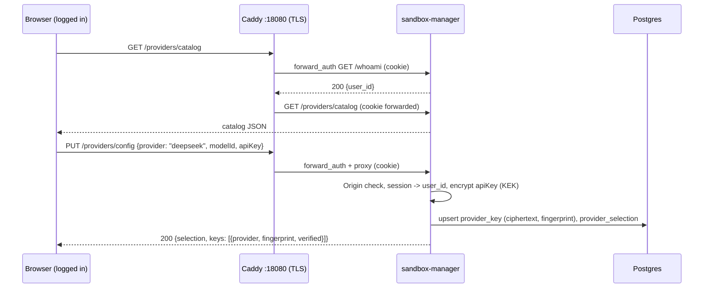

# RFC 0012 — BYOK: user-selected AI providers with per-user API keys

| Field | Value |
|---|---|
| Status | Draft |
| Author | Affido maintainers |
| Date | 2026-11-14 |
| Target | `sandbox-manager/`, `agent/model.ts`, `agent/tools.ts`, `agent/server.ts`, `caddy/Caddyfile`, `frontend/`, `docker-compose.yml` |
| Related | `docs/audit/secrets-and-llm-providers.md` (factual baseline), RFC 0003 (manager), RFC 0004 (operator key pool) |
| Supersedes | none; extends RFC 0004 §10 non-goal "Per-user BYOK" into a design |

## 1. Summary

Two facts first.

**Today the user cannot choose a provider.** The audit (`docs/audit/secrets-and-llm-providers.md`
§3.2) is explicit: the only operator-facing switch is `fake` vs `openrouter` via
`./dev.sh`, decided on the host before `docker create`. One stack ships one
`AGENT_IMAGE` and one shared `AGENT_SECRETS_DIR`, so all users share one key —
which is also readable inside every sandbox (audit §8.1). No end-user surface
exists: `POST /prompt` takes `prompt`, `requestId`, `citations`, nothing else.

**The model layer is already multi-provider.** This RFC studied `@earendil-works/pi-ai`
1.3.0 and `@earendil-works/pi-durable` 1.3.0 as installed in `agent/node_modules`;
§3 is that study. The short version: pi-ai's `Models` collection is designed to
hold many providers at once, its `createProvider()` builds arbitrary
OpenAI-compatible providers in a few lines, and pi-durable stores the model as a
`ModelRef {provider, modelId}` per conversation that can be reconfigured at
runtime without wiping the session. What neither library provides is the
control-plane half: key storage, delivery to the sandbox, an HTTP surface, and a
catalog for the UI. That half is this RFC.

**Proposal — BYOK (bring your own key).** An authenticated user picks a provider
from a curated catalog (or registers a custom OpenAI-compatible endpoint),
submits their API key over HTTPS through Caddy to the sandbox-manager, which
stores it encrypted in the OLTP as the *desired state*. The manager never puts
the key in the container environment or on the host filesystem: it delivers it
over the wire to the running agent at resolve time, the agent holds it in
memory only, and every activation reconciles the agent's runtime config against
the desired state. The agent-side wrapper accepts exactly two shapes: built-in
pi-ai provider factories and OpenAI-compatible endpoints built with
`createProvider()` + `openAICompletionsApi()`.

RFC 0004 (operator key pool + `llm-gateway`) stays valid as the *operator*
mode and the stricter no-key-in-sandbox evolution; §9 positions the two.

## 2. Requirements and threat model

### 2.1 Requirements

- **R1 — User selects provider and key.** An authenticated user can store one
  key per catalog provider, and choose one active `(provider, modelId)`.
- **R2 — Framework is provider-agnostic within the OpenAI-compatible family.**
  Adding a provider to the catalog must not require an agent code change; the
  wrapper constraint is "API interfaced with the OpenAI SDK surface"
  (`openai-completions` wire API).
- **R3 — No key in the container environment or image.** `docker inspect`,
  `/proc/1/environ`, and crash dumps must stay key-free (audit §5). The key is
  plaintext only in: the browser's POST, TLS-terminated Caddy memory, manager
  process memory, agent process memory, and OLTP ciphertext.
- **R4 — Durable across the sandbox lifecycle.** L0 pause, L1 stop, eviction,
  and container recreation must not lose or leak the binding; the key survives
  because the desired state is in Postgres, not in the container.
- **R5 — Switching provider or key must not require container recreation.**
  Container env is fixed at `docker create`; provider switching moves to runtime
  state (§3.4 is the mechanism that makes this possible).
- **R6 — No new published ports.** Manager API stays reachable only through
  Caddy `forward_auth` or the trusted-caller path.
- **R7 — Tests stay keyless.** `verify.sh` and e2e keep the faux default; the
  BYOK chain is proven against a fake OpenAI-compatible upstream.
- **R8 — Existing sessions survive a provider switch.** The conversation's
  stored `pi.agent` model is reconfigured (`configure()`), never wiped.
- **R9 — Both frontend modes keep working.** Caddy gateway mode and
  trusted-manager mode (`SANDBOX_MANAGER_URL`) both reach the new endpoints.

### 2.2 Threat model

Same trust boundaries as RFC 0004 §3, with the BYOK correction: **the key in
play is the user's own**, so "the user reads their own key inside their own
sandbox" is a UX/blast-radius concern, not a tenant-separation violation. What
must still hold:

1. User A cannot read, overwrite, or use user B's key (per-user isolation,
   session-authenticated writes, per-user networks).
2. The key is not observable by parties other than: the user, the control
   plane, and the provider. Concretely: no key in URLs, logs, `docker inspect`,
   host filesystem outside ciphertext, or GET responses.
3. An attacker cannot *spoof* the setup request: cannot set another user's
   key (session binding), cannot forge a setup request from a hostile page
   (CSRF), cannot impersonate the manager to the agent (network isolation).
4. "Detection": traffic analysis may reveal *that* a setup request happens,
   never *what* it carries (§8.3).

Out of scope, as in RFC 0004: host/Docker-daemon/manager compromise (root-
equivalent), and prompt confidentiality from the control plane.

## 3. What pi-ai and pi-durable already provide (study)

Every claim below is read from the installed packages
(`agent/node_modules/@earendil-works/pi-ai@1.3.0`, `pi-durable@1.3.0`).

### 3.1 `Models` is a runtime collection of providers

`createModels({ credentials, modelsStore })` returns a `MutableModels`
(`pi-ai/dist/models.d.ts:210`). `setProvider(provider)` upserts **by
`provider.id`**; providers coexist, and "Providers own request behavior;
`Models` resolves auth and delegates each request to the provider that owns the
model." Model identity across the stack is `{ provider, modelId }`. So one
sandbox can hold the faux provider, three catalog providers and a custom
endpoint simultaneously; switching is an upsert plus a stored-model change —
not a process restart.

### 3.2 Custom OpenAI-compatible providers are a first-class pattern

`createProvider(input)` (`pi-ai/dist/models.d.ts:252`) takes
`{ id, name, baseUrl, headers, auth, models, api }`. The built-in factories for
OpenAI-compatible vendors are exactly this shape — from
`pi-ai/dist/providers/deepseek.js`:

```js
createProvider({
  id: "deepseek", name: "DeepSeek",
  baseUrl: "https://api.deepseek.com",
  auth: { apiKey: envApiKeyAuth("DeepSeek API key", ["DEEPSEEK_API_KEY"]) },
  models: Object.values(DEEPSEEK_MODELS),
  api: openAICompletionsApi(),
})
```

`openAICompletionsApi()` is the OpenAI chat-completions wire implementation
shared by groq, together, fireworks, xai, cerebras, moonshot and others. The
`Model` type even carries `compat` overrides for OpenAI-compatible APIs that
are "auto-detected from `baseUrl`" when unset (`pi-ai/dist/types.d.ts:658`).
**Conclusion:** the R2 wrapper constraint is implemented by a ~10-line factory
`openAICompatProvider(id, baseUrl, models)` in `agent/model.ts`; no SDK work.

### 3.3 Credentials are app-owned and key to the provider id

`CredentialStore` (`pi-ai/dist/auth/types.d.ts`) is injected, keyed by
`provider.id`, one credential per provider. `modify(providerId, fn)` is the
only (serialized) write path — affido already uses it in `createModel()`.
Resolution order (`pi-ai/dist/auth/resolve.js`): **stored credential wins**;
ambient env vars are consulted only when nothing is stored. So a delivered key
needs no environment variable at all, and `envApiKeyAuth` factories work
unchanged. `InMemoryCredentialStore` is the natural store: the key lives in
agent RAM only (R3), and RAM loss is handled by re-delivery (§5.4).

### 3.4 pi-durable makes the model per-conversation runtime state

`ModelRef = { provider, modelId }` (`pi-durable/dist/harness/types.d.ts:9`) is
stored in the conversation's `pi.agent` (`AgentState.model`).
`conversation.configure({ model })` changes it in its own commit
(`pi-durable/dist/harness/types.d.ts:592`). Affido already relies on this:
`DurableHarness.#syncAgent` (`agent/harness.ts:234-249`) rewrites the stored
model on every open "so a provider switch would otherwise keep resolving the
old, now-unregistered model". `HarnessOptions.models` is the live collection
generation resolves through — mutations (`setProvider`, `credentials.modify`)
apply to subsequent model calls.

**This is the load-bearing finding:** nothing in the model stack requires a
container recreation to change provider, model, or key. Recreation is forced
only by things fixed at `docker create` — image, env, mounts, network mode.
Hence the design rule: *provider and key travel as runtime state through the
control plane, never as `docker create` inputs.*

### 3.5 What the libraries do not provide

Key storage and encryption, delivery to the sandbox, setup/validation HTTP
endpoints, a catalog for the UI, per-tenant isolation of any of it. Those are
the control plane's job and the rest of this RFC.

## 4. Design overview

```
              setup (rare)                                   activation (every resolve)
  browser ──HTTPS──> caddy /providers/* ──> manager ──> OLTP (ciphertext = desired state)
                        (forward_auth         │
                         session cookie)      │  resolve: ensure_started, wait_healthy
                                               ▼
                                        agent POST /config {provider, modelId, apiKey, baseUrl?}
                                               │  InMemoryCredentialStore.modify()
                                               │  models.setProvider(...)  (upsert)
                                               │  conversation.configure({model})
                                               ▼
                                        agent ──HTTPS──> provider API (sandbox egress open)
```

| Component | Owns | Never sees |
|---|---|---|
| browser | the key, while typing it | other tenants |
| caddy | TLS, routing, session forwarding | the key body (does not log bodies) |
| sandbox-manager | ciphertext + KEK, desired state, catalog, validation, delivery | — (trusted broker; sees plaintext in RAM during setup/delivery) |
| OLTP | `provider_key` ciphertext, `provider_selection` | KEK, plaintext |
| agent sandbox | runtime provider registry, in-memory credential, `ModelRef` per conversation | other tenants' keys, KEK, ciphertext |

The legacy `AGENT_SECRETS_DIR` mount (shared plaintext dir, audit §8.1) is
removed from the manager path; running the agent image standalone keeps the
secret-file branch of `createModel()`.

## 5. Component design

### 5.1 Provider catalog

Two kinds of catalog entries, both OpenAI-compatible:

- **Built-ins** — a curated allowlist of pi-ai factories (v1: `openrouter`,
  `openai`, `deepseek`, `groq`, `together`, `fireworks`, `xai`, `cerebras`,
  `mistral`), each with `{id, name, baseUrl, models[]}` from pi-ai's static
  catalogs, plus an optional `validatePath` (§5.6). The agent imports the
  matching factory and overrides nothing; the stored credential supplies the
  key (§3.3).
- **Custom endpoint** — `{id: "custom", name, baseUrl, models[]}` where the
  user supplies `baseUrl` and one or more model ids at setup. The agent builds
  it with the §3.2 factory.

The catalog is generated, not hand-maintained: a build-time step in the agent
image imports pi-ai's static model catalogs and emits `provider-catalog.json`;
the manager serves it verbatim. This pins catalog and wrapper to the same
`pi-ai` version (AGENTS.md dependency rule). Until that step lands, a static
JSON in the manager repo is the fallback (M4 makes generation mandatory).

Custom `baseUrl` rules: `https://` only (an explicit dev flag may allow
`http://` for the fake-upstream e2e); DNS name must not resolve into RFC1918
or docker networks (the manager-side key-validation request is the SSRF
surface here); length ≤ 2048.

### 5.2 Data model (OLTP, manager-owned)

```sql
CREATE TABLE provider_key (
  user_id     text        NOT NULL,   -- better-auth user id; no FK (see note)
  provider    text        NOT NULL,   -- catalog id, or 'custom'
  ciphertext  bytea       NOT NULL,   -- AES-256-GCM, AAD = user_id || provider
  nonce       bytea       NOT NULL,
  fingerprint text        NOT NULL,   -- sha256(key)[:12]; non-secret, for status UI
  base_url    text,                   -- custom endpoints only; NULL for built-ins
  verified_at timestamptz,            -- upstream validation verdict time, NULL = unverified
  status      text        NOT NULL DEFAULT 'active' CHECK (status IN ('active','revoked')),
  created_at  timestamptz NOT NULL DEFAULT now(),
  updated_at  timestamptz NOT NULL DEFAULT now(),
  PRIMARY KEY (user_id, provider)
);

CREATE TABLE provider_selection (
  user_id     text        NOT NULL,
  provider    text        NOT NULL,
  model_id    text        NOT NULL,
  updated_at  timestamptz NOT NULL DEFAULT now(),
  PRIMARY KEY (user_id)
);
```

Notes:

- **No FK to `sandbox_registry`**: a user can configure a provider *before* the
  first resolve provisions a sandbox; the registry row does not exist yet.
  Orphan cleanup is the account-deletion flow's job (§7.13).
- **Ciphertext, not plaintext** — reuses RFC 0004 §4.7's scheme: 32-byte KEK in
  `secrets/llm_key_kek`, mounted into the manager only; `AAD = user_id ||
  provider` binds each ciphertext to its owner so rows cannot be swapped.
- `fingerprint` is the only key-derived value any API ever returns (§8.3).

### 5.3 Manager HTTP surface

All endpoints sit behind the existing walls: peer guard, `X-Manager-Token`,
and — on the browser path — session validation. Browser-path identity always
comes from `user_from_session()`; a body/query `user_id` is cross-checked, and
for writes it is ignored outright (identity is the session, full stop).

| Method + path | Auth | Body / result |
|---|---|---|
| `GET /providers/catalog` | session or token | catalog JSON (§5.1); never keys |
| `GET /providers/config` | session or token | `{ selection: {provider, modelId} \| null, keys: [{provider, fingerprint, verifiedAt, baseUrl?}] }` |
| `PUT /providers/config` | session or token | `{provider, modelId, apiKey?, baseUrl?}` → upsert key (when `apiKey`), set selection, optionally validate upstream, apply live (§5.4). Returns the masked view, never the key |
| `DELETE /providers/config` | session or token | clears selection; `?provider=` also revokes that key |
| `GET /whoami` | session only | `{user_id}` — the Caddy `forward_auth` URI for `/providers/*` (no provisioning, unlike `/resolve`) |

Caddy gains one route before `@u`:

```caddyfile
@providers path /providers/*
handle @providers {
	forward_auth sandbox-manager:8090 {
		uri /whoami
		header_up X-Manager-Token {env.MANAGER_TOKEN}
	}
	reverse_proxy sandbox-manager:8090
}
```

Trusted-caller mode (SvelteKit server routes with `SANDBOX_MANAGER_URL`) posts
the same payloads with `X-Manager-Token` and an explicit `user_id`, mirroring
`POST /resolve` today (`frontend/src/lib/server/sandbox.ts:34-53`). Both modes
are first-class (R9); the Caddy route is the one browsers use.

### 5.4 Delivery and reconciliation (the core loop)

The manager never writes the key into anything `docker create` owns. It
delivers it to the running agent and reconciles on every activation:

1. `resolve()` finishes `ensure_started` + `wait_healthy` (unchanged).
2. Manager reads desired `provider_selection` + `provider_key`.
3. Manager reads the agent's `GET /status`; it reports
   `{ model: {provider, modelId}, keyFingerprint }` (fingerprint only, §8.3).
4. If desired is set and `(provider, modelId, fingerprint)` differs → decrypt,
   `POST http://<container>:8080/config` with
   `{provider, modelId, apiKey, baseUrl?}` (the manager is already attached to
   the per-user network and already speaks to the agent for `/health`).
5. If desired is unset and the agent runs a non-faux provider →
   `POST /config {provider: "faux", modelId: "faux-1"}`.

Agent-side `POST /config` (idempotent, serialized with prompts on the agent's
existing promise chain — `DurableHarness`'s serialization discipline,
AGENTS.md Durability Invariants):

```ts
// sketch, agent/model.ts + tools.ts
await credentials.modify(provider, async () => ({ type: "api_key", key: apiKey }));
models.setProvider(buildProvider({ id, baseUrl, models }));   // §3.2 factory or built-in
await conversation.configure({ model: { provider, modelId } }); // pi-durable, in its own commit
```

`buildProvider` resolves catalog built-ins to their pi-ai factory and
everything else to `createProvider({ id, baseUrl, auth, models,
api: openAICompletionsApi() })`. After `setProvider` + `configure`, the next
model call dispatches to the new provider (§3.1, §3.4) — **no restart, no
recreation** (R5).

Why memory-only in the agent (and why that is enough): the key's durable home
is the OLTP ciphertext. RAM loss paths — L0 pause keeps the process, L1 stop
kills it, eviction stops it, recreation replaces it — are all covered by step 4
of the next resolve. Nothing secrets-shaped ever lands in `/data` or
`/workspace` (R3, R4), and an idle-stopped sandbox holds no key material at
all, which is a strictly better resting state than a mounted file.

Reconciliation also heals drift: a user driving their own sandbox's `/config`
directly through `/u/<id>/config` (same forward_auth wall) can only desync
their own runtime until the next resolve overwrites it from desired state.
Desired state has exactly one writer per user: the manager.

### 5.5 Egress

Real providers need internet egress; per-user networks are created `--internal`
when `AGENT_EGRESS=off` (`sandbox_manager.py:107-118`), and network mode is
fixed at network-create time. Per-domain egress is not expressible with plain
bridges. v1 therefore: **BYOK with any real provider requires
`AGENT_EGRESS=open`** (stack-level, documented in `.env.example`), and the
manager rejects `PUT /providers/config` with `provider != faux` and a clear
`egress_blocked` error when `AGENT_EGRESS != open` — fail closed at setup, not
at first prompt. The faux default for `verify.sh` (R7) is untouched: no
selection, no egress. Dual-network sandboxes (internal + egress attach on
demand) are deferred (§11).

### 5.6 Upstream key validation (optional, at setup)

The manager can validate before storing: `Authorization: Bearer <key>`, 10s
timeout, result cached in `verified_at` / surfaced as `verified: true|false`,
on `GET {base}{validatePath}`. `validatePath` is a catalog-entry field whose
default is `/models`; an entry overrides it when its `/models` does not
actually check auth. OpenRouter pins `/key` (its auth-required account
endpoint): `GET openrouter.ai/api/v1/models` is public and ignores the
`Authorization` header — any garbage key answers 200 there, so a `/models`
check stamped keys `verified` while proving nothing, and a wrong-provider key
(a DeepSeek key pasted under openrouter, observed 2026-10-25) only failed at
the first prompt as `model_error: 401 "Missing Authentication header"`.
`/key` 401s for any key that is not a real `sk-or-v1-…` key, closing that
hole at setup. The manager still shape-checks the suffix before building the
request line (it comes from the operator-built agent image, the same trust
level as the pinned `baseUrl`).

This is a UX nicety (catch typos early), not a gate: a provider whose
upstream serves neither endpoint usefully is stored unverified and failures
surface at prompt time as `model_error`. The request originates from the
manager (normal NAT egress), never from the sandbox, and only to the
catalog's pinned `baseUrl` — the SSRF surface of §5.1's custom-endpoint
rules.

## 6. Happy paths

### 6.1 First-time setup (no sandbox yet)



No sandbox is provisioned by setup; the first `/u/<id>/prompt` resolve does
that and then delivers the key (§5.4).

### 6.2 First prompt after setup (cold sandbox)

1. `POST /u/<id>/prompt` → Caddy `forward_auth /resolve` → manager provisions
   (network `open`, volumes, container), `wait_healthy`.
2. Resolve step 2-4: desired ≠ agent status → `POST /config` → agent
   `setProvider(deepseekProvider())`, `credentials.modify`, `configure`.
3. Caddy proxies the buffered `POST /prompt` to the agent.
4. pi-durable generation resolves `ModelRef` through the updated collection;
   the agent streams from `https://api.deepseek.com` over sandbox egress.
5. `PromptResult` returns through Caddy; nowhere in the exchange does the key
   appear outside the `POST /config` hop on the per-user network.

### 6.3 Key rotation, sandbox running

`PUT /providers/config {provider: "deepseek", modelId, apiKey: <new>}` →
ciphertext upsert, `fingerprint` changes. The user's *next* request triggers
resolve → mismatch on fingerprint → `POST /config` re-delivery. In-flight
prompt (if any) completes on the old key; the switch applies between prompts
because `/config` and `/prompt` serialize on the same chain.

### 6.4 L1 stop overnight, first prompt next morning

Container stopped by the eviction tick (`sandbox_manager.py`, `eviction_tick`);
key evaporated with the process (by design). Morning resolve: `ensure_started`
→ `wait_healthy` → status shows faux/no-fingerprint → re-deliver from
ciphertext → prompt proceeds. Session SQLite on `/data` was never touched.

### 6.5 Second provider added, selection switched

User adds a `groq` key (both keys now stored), later selects
`{provider: "groq", modelId}`. Same delivery loop; the deepseek credential
stays in the store (one credential per provider id, §3.3) so switching back is
a selection change only. Conversation keeps its history; `configure()` swaps
the `ModelRef` per R8.

## 7. Edge cases

Ordered roughly by pain.

### 7.1 In-flight prompt during a provider switch
`POST /config` waits on the agent's serialization chain; an in-flight prompt
runs to completion on the old provider. A *queued* prompt behind it runs on
the new one. Both orders are correct and need no cancellation.

### 7.2 Key invalid (typo, revoked upstream)
With validation (§5.6): `PUT` answers `400 invalid_key` and stores nothing.
Without: stored unverified; the first prompt settles `model_error` with the
provider's status text (existing `PromptResult.reasonDetail` path). The
frontend surfaces the fingerprint + `verified` flag so the user can tell a
stored-but-unverified key apart.

### 7.3 Custom endpoint lies about being OpenAI-compatible
Symptoms: 404 on `/chat/completions`, non-streaming bodies, thinking-token
quirks. pi-ai's `compat` overrides (auto-detected from `baseUrl`, §3.2) absorb
the common ones; the rest surface as `model_error` with the upstream body
truncated. Not recoverable automatically; the catalog can pin known quirks
per custom entry later.

### 7.4 Custom `baseUrl` points inside the infrastructure
Rejected at `PUT` time (§5.1 rules: https-only, no RFC1918/docker-network DNS
answers, checked again before each manager-side validation request). The
*sandbox's* outbound calls are not filtered per-host (§5.5) — with BYOK this
is the user's own exfiltration risk, documented, not enforced in v1.

### 7.5 Sandbox runs image that predates `/config`
Manager detects 404 on `POST /config` and answers `503 agent_image_old` on
resolve, same repair philosophy as `dev.sh`'s image-mismatch warning. Upgrade
path: rebuild image; volumes and ciphertext desired state make the old runtime
state irrelevant.

### 7.6 Stored conversation references a provider the user deselected
`configure()` pins the active conversation to the selection. But an older
conversation switched to via `/session/switch` may carry a `ModelRef` whose
provider is no longer registered. `#syncAgent` already aligns *deployment*
models on open; the same repair applies the desired selection when the stored
model's provider is absent from the collection. Sessions are never wiped (R8).

### 7.7 Concurrent setups from two tabs
`PUT` is last-write-wins on `updated_at`; keys are keyed `(user_id, provider)`
so two different providers do not collide. Two writes for the *same* provider
resolve to whichever committed last; the next resolve reconciles the runtime
to it. No advisory lock needed beyond the row upsert.

### 7.8 User deletes their key while a sandbox is running
`DELETE` clears selection (and the row with `?provider=`). Desired state
becomes "faux"; next resolve delivers faux config; the in-memory credential of
the removed provider stays until overwritten — harmless (unused), and the
process losing RAM removes it for good.

### 7.9 KEK lost / rotated
Keys are unrecoverable; the UI must ask users to re-enter (manager answers
`503 kek_unavailable` on decrypt failure — never a silent faux fallback in
production, mirroring RFC 0004's fail-closed stance). KEK rotation re-encrypts
all rows under a new `kdf_version` in one transaction; the RFC 0004 §4.7
runbook applies verbatim.

### 7.10 Manager restart mid-delivery
Delivery is idempotent and reconciled: a restart between `wait_healthy` and
`POST /config` leaves the agent on the old config; the *next* resolve
completes the delivery. No partial state exists on the agent (config is one
POST, applied atomically by the serialization chain).

### 7.11 `AGENT_EGRESS=off` while a real provider is selected
Configuration drift (e.g. operator flips the env). Manager refuses delivery
with `egress_blocked` and resolve answers 503 with that reason — the sandbox
never silently degrades to faux when the user chose a real provider (audit
§8.6's surprise-switch problem, now impossible by construction).

### 7.12 `verify.sh` / CI
No selection, no keys: faux, `AGENT_EGRESS=off`, unchanged (R7). The BYOK
chain is exercised by M2's fake OpenAI-compatible upstream (§10).

### 7.13 Account deletion
Better-auth owns the user row; the manager does not FK to it (§5.2). The
frontend account-deletion flow must call `DELETE /providers/config?all=1`
(manager: drop both tables' rows for the user). Missed calls leave inert
ciphertext; a periodic reconcile that drops `provider_*` rows for user ids
absent from better-auth's `user` table is the belt-and-braces (open question
4).

### 7.14 Spoofing and hostile requests (see also §8)
Cross-tenant writes: impossible — browser path identity is the session cookie
validated against the session table; body `user_id` is ignored for writes.
CSRF: `PUT`/`DELETE` only, JSON body, Origin/Referer checked against the
Caddy origin, session cookie SameSite=Lax or stricter (better-auth default) —
a hostile page can neither forge the custom-header check nor ride the cookie.
Fake manager → agent: the agent accepts `/config` from network peers only;
peers on a per-user network are exactly the control-plane guests (peer guard,
audit §4.3) plus the user themself — both already trusted with everything the
endpoint can do.

### 7.15 Docker-network flapping during delivery
`POST /config` fails → resolve fails with 503 as today; registry stays
`running`/`error` per existing paths; the reconcile tick repairs. Delivery has
no timeout side effects on the agent.

## 8. Security analysis

### 8.1 Where plaintext key material exists

| Location | Plaintext? | Bound |
|---|---|---|
| Browser memory / POST body | yes | TLS to Caddy; user's own machine |
| Caddy | buffered reverse proxy only | never logged (path+status only); process memory |
| Manager, during `PUT`/delivery/optional validation | yes | process memory; no body logging; peer guard + token + session walls |
| OLTP | no | AES-256-GCM ciphertext, AAD-bound |
| Agent process | yes, by design | `InMemoryCredentialStore`; user's own sandbox and key |
| Agent filesystem, `/data`, `/workspace`, image, env | no | R3; asserted by an M4 test |
| Host filesystem | no (KEK file excepted, 0600, gitignored) | replaces today's plaintext `secrets/*_api_key` mounts |
| Any log | no | §8.3 |

### 8.2 Spoofing matrix

| Attack | Wall |
|---|---|
| Set another user's key | session-bound writes; body user_id ignored |
| CSRF from hostile page | POST/JSON-only + Origin check + SameSite cookie |
| Sandbox peer calling the manager | peer guard rejects sandbox subnets before any handler |
| Attacker without `MANAGER_TOKEN` on trusted path | `authorized()` compare_digest wall |
| Fake agent status to skip delivery | status is fetched from the container over its per-user network; spoofing requires being on that network |
| Replay of a captured `POST /config` | the body is the user's own key to their own sandbox; replays converge to desired state (idempotent) |

### 8.3 Detection / traffic analysis

**TLS is a deployment prerequisite, not current behavior.** The Caddyfile
serves plain HTTP on `:80` (published `127.0.0.1:18080`, no `tls` directive);
that is acceptable only for the loopback dev stack. Production must terminate
TLS at Caddy (automatic HTTPS on a public site address, or `tls internal` for
private deployments): on the browser path Caddy sets `X-Forwarded-Proto`, and
the manager rejects `PUT /providers/config` unless it is `https` (or an
explicit dev flag allows http), so a key can never be submitted in cleartext
by misconfiguration. The trusted-caller path (SvelteKit → manager) is exempt:
server-to-server on the docker network, and its browser-facing hop carries the
same requirement at the frontend's own edge. Internal hops after termination (`forward_auth`
subrequest, delivery `POST /config`) stay HTTP on docker networks, like the
session cookie today.

TLS at the edge buys three properties this design relies on: (a) server
authentication bound to the exact domain — the client verifies the CA chain
and the hostname, so a MITM would need a CA-issued certificate for our
domain, not just any signed blob; (b) confidentiality of the key material in
transit; (c) forward secrecy — TLS 1.3's ephemeral (EC)DHE means the server's
private key authenticates the handshake but never encrypts traffic, so a
later key compromise does not decrypt past captures containing user API
keys.

An observer of the browser link learns *that* a setup request happened (path
`/providers/config`, method, size class) and nothing else: TLS hides content;
the key is never in a URL, query, or header on that hop; responses carry only
`fingerprint` (12 hex of sha256 — not invertible, not a prefix of the key);
logs at Caddy and the manager record path/status, never bodies; GET
`/providers/config` is cache-disabled (`Cache-Control: no-store`) so no
intermediary retains it. On the internal hops (`/whoami` subrequest,
`/config` delivery) traffic stays inside docker networks. The optional
upstream validation adds one manager→provider request whose timing/size is
observable to the provider only — which already sees the key anyway.

### 8.4 Residual risks

- A TLS-terminating proxy the *user's machine already trusts* (corporate MITM
  root CA, managed browser) reads the key despite correct TLS. This is a
  compromised-client case: out of scope here, noted because it is the one
  "attacker decrypts" path the §8.3 TLDR does not exclude.
- The agent's own `bash` can read its user's key from process memory (same
  container, same UID — audit §5). BYOK shrinks this from "all tenants' keys"
  to "the user's own key"; the strict fix is RFC 0004's gateway mode.
- Prompt plaintext passes through the agent only; with BYOK the control plane
  never sees prompts at all (no gateway on the model path).
- Key ciphertext + KEK both on one host (single-node compose) — accepted
  baseline, identical to RFC 0004 §9.

## 9. Alternatives considered

| Alternative | Verdict |
|---|---|
| Key as env var at `docker create` | **Rejected.** `docker inspect`/`/proc/1/environ` exposure (audit §5); rotation forces recreation; violates R3/R5. |
| Per-user key file bind-mounted at `/run/secrets` | **Rejected.** Plaintext on host fs and in-container (readable via `bash`); rotation forces recreation; keeps two sources of truth. |
| RFC 0004 `llm-gateway` for BYOK | **Deferred, not rejected.** Strongest isolation (key never in sandbox) and the natural operator-pool companion; costs a new service, KEK ops, per-request proxying. BYOK's threat model (own key, own sandbox) does not justify it for v1; §8.4 names it the strict upgrade. |
| Per-sandbox sidecar holding the key | **Rejected for v1** (as in RFC 0004 §8): doubles container count for a benefit the gateway achieves more cheaply. |
| Storing the key encrypted inside `/data` for offline boots | **Rejected.** The decryption key would have to live in the sandbox too (env/derived), reducing to obfuscation; desired-state + re-delivery achieves the same durability honestly. |
| Env-only credential (no store) via `overrides.apiKey` | **Rejected.** pi-ai's stored-credential path is the documented one and survives pi upgrades; `modify()` gives serialization for free. |

## 10. Verification

Default gate stays keyless (R7). New material:

- **M1 — manager.** Ciphertext round-trip (KEK, AAD swap rejected); catalog
  served; `PUT/GET/DELETE` session binding (cross-user 403, token path 401);
  `egress_blocked` when `AGENT_EGRESS=off`; log scan: no key bytes in manager
  stdout on any path including exception traces.
- **M2 — end-to-end with a fake upstream.** An e2e-only container implements
  `/v1/chat/completions` (streaming) and `/v1/models`; the catalog gains a
  `e2e-fake` entry pointing at it (http allowed by the dev flag). Assert:
  setup via Caddy → first prompt answers from the fake upstream → the
  upstream saw `Authorization: Bearer <key>` exactly once (delivery) → agent
  `/status` shows the fingerprint → rotation changes the bearer seen →
  `docker exec … env`/`/data` greps find no key.
- **M3 — durability.** With `e2e-fake`: L0 pause + resolve → same model,
  same fingerprint; `docker stop` + resolve → re-delivery, session and entries
  intact; `docker rm` + resolve → reprovision + re-delivery, session intact.
- **M4 — security.** CSRF (no-Origin PUT → 403), peer guard on `/providers/*`,
  `no-store` on config GET, `provider_key` rows unreadable without KEK,
  account-deletion cascade.

## 11. Open questions

1. **Per-conversation providers.** `provider_selection` is per-user; the
   `ModelRef` is per-conversation. Should the UI offer per-chat model choice
   (a selection override stored in the conversation)? Mechanically supported
   today (§3.4); it is a product decision.
2. **Egress granularity.** Dual networks per sandbox (internal + egress
   attached only when a real provider is selected) would tighten §5.5 at the
   cost of network lifecycle in `provision()`. Worth it only if `open` becomes
   unacceptable.
3. **Catalog generation point.** Build-time export from pi-ai inside the agent
   image vs a CI job vs manager-bundled JSON (§5.1). M4 decides; generation is
   the no-drift answer.
4. **Orphan cleanup ownership.** Reconcile tick dropping `provider_*` rows for
   deleted better-auth users vs requiring the frontend to call the DELETE.
   Both are cheap; one must own it.
5. **Thinking levels per provider.** `THINKING_LEVEL` is deployment-wide env
   today; per-selection thinking (some OpenAI-compatible endpoints reject
   `reasoning`) may need to ride along in `provider_selection`.

## 12. Milestones

1. **M1 — manager storage and API.** Tables, KEK handling, `/providers/*`,
   `/whoami`, egress gate, session/token auth, M1 tests.
2. **M2 — agent runtime config.** `POST /config` + `/status` fingerprint,
   `buildProvider` (built-ins + `openAICompletionsApi` custom), resolve-time
   reconciliation, e2e with the fake upstream.
3. **M3 — frontend.** Settings UI (catalog, key entry, selection, verify),
   SvelteKit routes for both modes, status surfacing.
4. **M4 — hardening.** Catalog generation from pi-ai, security suite
   additions, `.env.example`/README updates, remove `AGENT_SECRETS_DIR` from
   the manager path.
